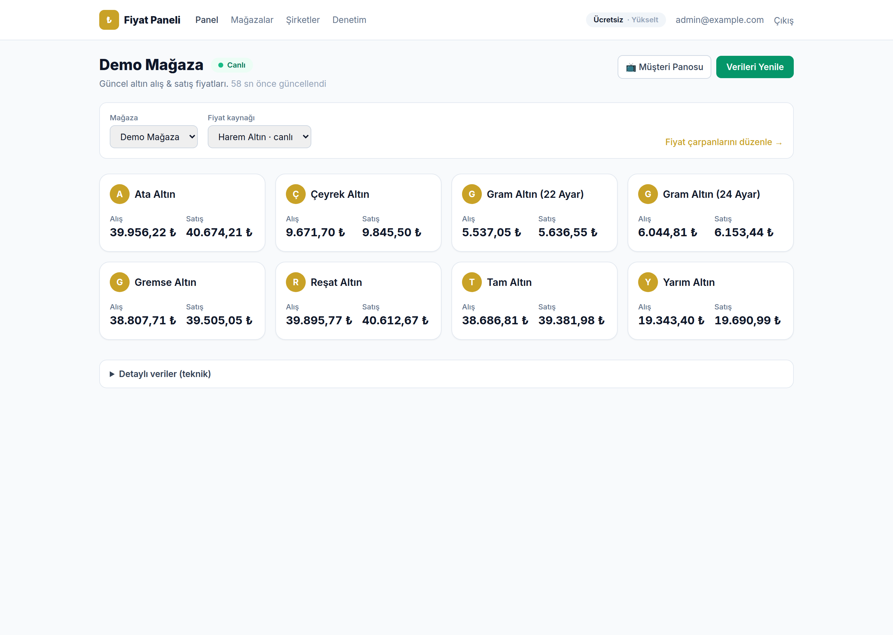
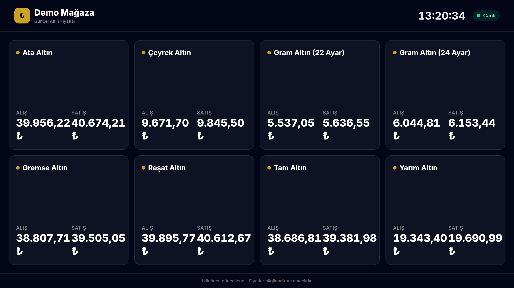
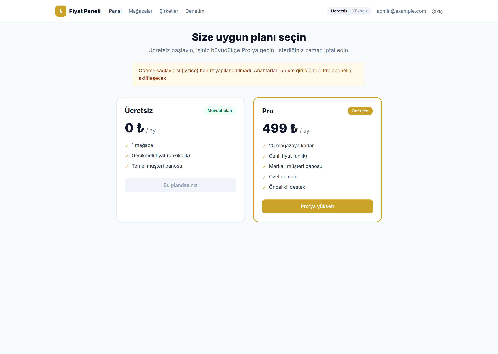
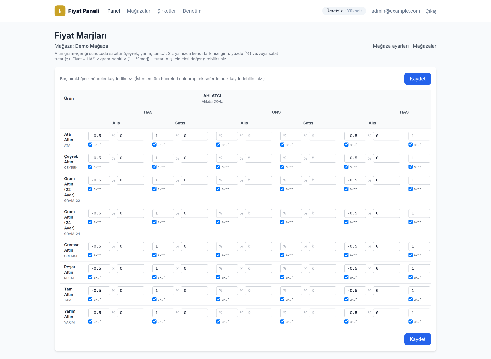

# Fiyat Paneli

**Kuyumcular için canlı altın fiyatı & müşteri panosu SaaS'ı.**

Fiyat Paneli; kuyumcuların ham piyasa verilerini (HAS/ONS) birden çok kaynaktan toplayıp kendi marjlarıyla ürün fiyatlarına dönüştürmesini, bu fiyatları **saniye saniye canlı** olarak hem kendi panellerinde hem de dükkandaki müşteri panosunda (TV/tablet) göstermesini sağlar. Çok kiracılı yapı, abonelik planları ve iyzico ödeme akışıyla uçtan uca bir SaaS örneğidir.

> ℹ️ **Portfolyo projesi.** Ödeme (iyzico) entegrasyonu **guard'lı** çalışır — API anahtarı olmadan sistem "yapılandırılmamış" modda ayakta kalır, `.env`'e anahtarlar girildiğinde abonelik akışı canlıya geçer.

**Teknolojiler:** Laravel 12 · PHP 8.4 · **Laravel Reverb** (WebSocket) · Blade + Tailwind CSS · SQLite/MySQL · iyzico · PHPUnit · PM2

---

## Öne çıkanlar

- ⚡ **Gerçek zamanlı fiyat** — HAREM'in Socket.IO yayınına bağlanan bir köprü daemon'u (`harem:listen`), her tick'i **Reverb** üzerinden tarayıcıya anlık push eder. Bağlantı koparsa otomatik polling'e düşer.
- 🪙 **Sunucu-hesaplı fiyatlama** — ürünün gram-altın içeriği sunucuda sabit (çeyrek, yarım, tam…); mağaza yalnızca kendi **marjını** (yüzde ve/veya sabit tutar) girer. `Fiyat = HAS × gram-sabiti × (1 + %marj) + tutar`.
- 📺 **Müşteriye dönük pano** — her mağazanın kendi slug'lı, markalı, tam ekran (dark) fiyat panosu — dükkanda TV/tablette gösterime uygun.
- 🔀 **Çoklu kaynak + sağlık skoru** — AHLATCI / NADIR / HAREM; deterministik sıralama, hata durumunda otomatik yedekleme (`source_health`).
- 💳 **Abonelik & ödeme** — Ücretsiz / Pro planları, plan kotaları (max mağaza, canlı fiyat, markalı pano), iyzico aylık abonelik + webhook senkronu.
- 🏢 **Çok kiracılılık** — mağaza→sahip ilişkisi; plan limitleri sahip bazında uygulanır (Pro'ya yükseltme yönlendirmesi).
- 🧾 **Denetim kaydı & izleme** — yönetici aksiyonları (mağaza/marj/abonelik) loglanır; `monitor:health` daemon heartbeat ve veri tazeliğini izleyip uyarır.
- 🎨 **Sade arayüz** — teknoloji bilmeyen kullanıcı için jargonsuz, kart-tabanlı tasarım; ham/teknik veriler "Detaylı veriler" altında gizli.

## Ekran görüntüleri

**Operatör paneli** — canlı fiyat, ürün kartları



**Müşteri panosu** — tam ekran, markalı, TV/tablet dostu



| Planlar & Abonelik | Fiyat marjları |
|---|---|
|  |  |

## Demo hesabı

`migrate --seed` sonrası hazır gelir (parola: `password`):

| E-posta | Rol | Açıklama |
|---|---|---|
| `admin@example.com` | admin | Demo mağaza, ürünler ve marjlarla dolu |

## Kurulum

```bash
git clone <repo> && cd borsa
composer install
cp .env.example .env
php artisan key:generate
touch database/database.sqlite      # SQLite (varsayılan)
php artisan migrate --seed
php artisan reverb:install          # REVERB_* .env'e yazılır
```

## Çalıştırma

Sistem birkaç kalıcı süreç ister (WebSocket santralı, kuyruk, zamanlayıcı, canlı akış). **PM2 ile tek komut** ([ecosystem.config.cjs](ecosystem.config.cjs)):

```bash
npm install -g pm2
pm2 start ecosystem.config.cjs      # reverb + queue + cron + harem
APP_SERVE=1 pm2 start ecosystem.config.cjs   # yerelde web sunucusunu da ekle
pm2 status ; pm2 logs
```

| PM2 adı | Görev |
|---|---|
| `reverb` | Event'leri tarayıcılara dağıtan WebSocket santralı |
| `queue` | Broadcast job'ları |
| `cron` | `schedule:work` — piyasa güncelleme + sağlık izleme |
| `harem` | HAREM canlı akış daemon'u |

> Üretimde web'i nginx + php-fpm sunar; `REVERB_HOST`'u genel alan adına, `REVERB_SCHEME`'i `https`'e ayarlayıp nginx ile `wss://alanadi → :8080` proxy'leyin.

## Mimari

Katmanlı yapı: **Controller → Service → (DTO/Model) → Cache/Broadcast**.

```
app/
├── Http/Controllers/       # HTTP; Dashboard, Billing, Admin/*
├── MarketData/
│   ├── Clients/            # AHLATCI/NADIR/HAREM kaynak istemcileri
│   ├── Support/            # HaremSocketReader (Socket.IO köprüsü), NumberParser
│   ├── MarketQuoteService  # çekme + upsert + broadcast
│   └── SourceSelector      # sağlık skoruna göre sıralama
├── Pricing/               # PricingCalculator + StorePricingService
├── Services/              # IyzicoService, SourceHealthService
├── Console/Commands/      # harem:listen (daemon), monitor:health, market:update
├── Events/                # MarketQuotesUpdated, StorePricesUpdated … (broadcast)
├── Http/Middleware/       # EnsurePlanFeature (plan kapısı)
└── Models/                # Store(owner), Product(has_factor), Subscription, AuditLog…
```

**Canlı akış:**

```
HAREM socket ──(harem:listen)──> DB/cache + fiyat hesap ──> broadcast
                                                            └─> queue ─> Reverb ─> tarayıcı
                                                                (private-store.{id})
```

HAREM eski HTTP uçlarını kaldırıp Socket.IO'ya geçti; köprü daemon tek bir kalıcı bağlantı tutup her `price_changed`'i pipeline'a besler. Daemon çalışmıyorsa cron bir **heartbeat** yedeğiyle HAREM'i tek-seferlik çeker. Ayrıntı: [docs/REALTIME.md](docs/REALTIME.md).

## Planlar & ödeme (iyzico)

Ücretsiz / Pro planları [config/plans.php](config/plans.php)'de tanımlı (fiyat, limitler). Abonelik akışı hazır; anahtarlar girilince aktifleşir:

```env
# Ödeme (iyzico) — boşken "yapılandırılmamış" mod; doldurunca canlı
IYZICO_API_KEY=
IYZICO_SECRET_KEY=
IYZICO_BASE_URL=https://sandbox-api.iyzipay.com
IYZICO_PRO_PLAN_REF=          # iyzico panelindeki Pro pricing plan referansı

# Reverb (self-hosted WebSocket)
BROADCAST_CONNECTION=reverb
REVERB_APP_ID= ; REVERB_APP_KEY= ; REVERB_APP_SECRET=
REVERB_HOST=localhost ; REVERB_PORT=8080 ; REVERB_SCHEME=http

# Canlı akış
MARKET_STREAMED_SOURCES=HAREM
```

Webhook (`/billing/iyzico/webhook`) HMAC-SHA256 imzayla doğrulanır ve abonelik yenileme/iptal olaylarını senkronlar.

## Test

```bash
php artisan test
```

Kapsam: fiyat hesaplama (gram-sabiti + marj), mağaza fiyatlama servisi, HAREM socket parsing, kaynak istemcileri.

## Dokümantasyon

- 🔌 [**docs/REALTIME.md**](docs/REALTIME.md) — REST → WebSocket dönüşümü, kanallar, HAREM köprüsü
- 🧭 [**docs/ANALYSIS.md**](docs/ANALYSIS.md) — sistem/mimari/güvenlik analizi
- ⚙️ [docs/KURULUM.md](docs/KURULUM.md) · [docs/NADIRDOVIZ_API_SETUP.md](docs/NADIRDOVIZ_API_SETUP.md) · [docs/ORNEKLER.md](docs/ORNEKLER.md)

## Lisans

MIT
